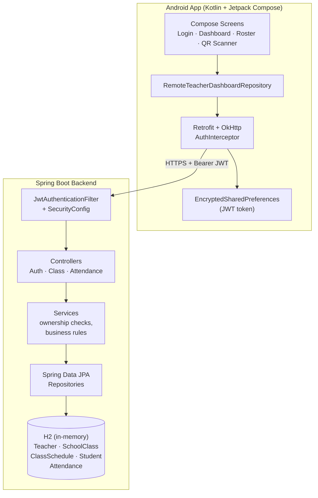

# Aivya — School Management (Teacher App)

A production-style teacher portal for schools: sign in, view assigned
classes and their weekly timetable, and take daily attendance either by
hand or by scanning each student's ID-card QR code. The Android client
talks to a real, independently deployed backend — there is no hard-coded
business data anywhere in the UI.

**Live demo:** https://aivya-school-management-application.onrender.com
**Demo login:** `teacher@aivya.edu` / `AivyaDemo@2026`

---

## Table of contents

- [Features](#features)
- [Architecture](#architecture)
- [Tech stack](#tech-stack)
- [Project structure](#project-structure)
- [Getting started](#getting-started)
- [API reference](#api-reference)
- [Security](#security)
- [Known limitations](#known-limitations)

---

## Features

**Classes & timetable**
- A teacher sees only the classes assigned to them, pulled live from the backend.
- Each class carries a real weekly schedule; tapping a class shows the full
  Monday–Saturday timetable, not just "today."
- Class cards show a time-aware status at a glance — **Ongoing**,
  **Upcoming**, **Missed** (unmarked after the period ended), or **Marked**
  — computed from the current time against that class's schedule.

**Attendance**
- Manual roll-call: mark each student Present / Absent / Late from the roster.
- QR check-in: scan a student's ID-card QR code with the camera to mark
  them present instantly — built on CameraX + ML Kit, with a live preview
  and a cooldown so one scan can't double-fire.
- The app never shows a success state the server hasn't actually
  confirmed; a submission failure keeps the teacher on the review screen
  with the real error instead of a false "done."

**Reliability & UX**
- Full-screen offline state when the device itself has no internet,
  separate from backend errors (which show inline with Retry).
- Calm, specific error messages for timeouts, server errors, and expired
  sessions instead of raw exceptions or silent failures.
- Loading and empty states throughout — classes, rosters, and history
  never show stale or placeholder data as if it were real.

**Security**
- Stateless JWT authentication; the token is stored in
  `EncryptedSharedPreferences` (AES-256-GCM via the Android Keystore),
  never in plain text or logged.
- Every attendance and roster endpoint is scoped server-side to the
  signed-in teacher's own classes — not just hidden in the UI.

---

## Architecture

Two independently deployable services: a Kotlin/Compose Android client and
a Spring Boot REST API, talking over HTTPS with JWT bearer auth.



**Request flow for attendance (manual or QR):**

1. The app sends `Authorization: Bearer <token>` with every request after login.
2. `JwtAuthenticationFilter` validates the token and loads the teacher's identity
   into the security context — no session state is kept server-side.
3. The service layer re-checks that the requested class actually belongs
   to that teacher before reading or writing anything (`AttendanceService`,
   `ClassService`) — ownership is enforced in code, not assumed from the UI.
4. A write (manual submit or QR check-in) upserts `Attendance` rows and
   returns the server's recomputed summary; the app only shows success
   once that response comes back.

---

## Tech stack

| Layer | Technology |
|---|---|
| Android UI | Kotlin, Jetpack Compose, Material 3 |
| Networking | Retrofit, OkHttp, Gson |
| Camera / QR | CameraX, ML Kit Barcode Scanning |
| Secure storage | AndroidX Security-Crypto (`EncryptedSharedPreferences`) |
| Backend | Java 21, Spring Boot 4, Spring Web MVC |
| Auth | Spring Security (stateless), JWT (`jjwt`) |
| Persistence | Spring Data JPA, Hibernate, H2 (in-memory) |
| Deployment | Docker, Render (free tier) |

---

## Project structure

```
Aivya-School-Management-Application/
├── android/                          Kotlin + Jetpack Compose app
│   └── app/src/main/java/com/aivya/schoolmanagement/
│       ├── MainActivity.kt           App root: auth state, offline gate
│       ├── auth/TokenStore.kt        Encrypted JWT + session storage
│       ├── network/                  Retrofit API, DTOs, connectivity check
│       └── dashboard/
│           ├── TeacherDashboardScreen.kt   Home · Classes · Attendance · Profile
│           ├── DashboardModels.kt          UI models, timetable/status logic
│           ├── attendance/                 Roll-call flow (manual + QR)
│           ├── scanner/QrScannerScreen.kt  CameraX + ML Kit QR scanning
│           └── data/                       Repository (real + interface)
│
└── backend/                           Spring Boot REST API
    └── src/main/java/com/aivya/backend/
        ├── controller/                Auth, Class, Attendance endpoints
        ├── service/                   Business logic + ownership checks
        ├── entity/                    Teacher, SchoolClass, ClassSchedule,
        │                              Student, Attendance (JPA)
        ├── repository/                Spring Data JPA repositories
        ├── security/                  JWT filter + token service
        └── config/                    SecurityConfig, API error handling
```

---

## Getting started

### Backend
```bash
cd backend
./mvnw spring-boot:run
```
Starts on `http://localhost:8080`. A demo teacher, 3 classes, their weekly
schedules, and synthetic students are seeded automatically on first run —
see [`backend/README.md`](backend/README.md) for the full API contract and
deployment steps.

### Android
Open `android/` in Android Studio and run it. It's already pointed at the
live backend above, so it works out of the box on an emulator or a real
device with internet. To use a local backend instead, change
`API_BASE_URL` in
`android/app/src/main/java/com/aivya/schoolmanagement/network/ApiClient.kt`
to `http://10.0.2.2:8080/` (emulator) or your machine's LAN IP (real device).

---

## API reference

All endpoints except `/api/v1/health` and `/api/v1/auth/login` require
`Authorization: Bearer <token>`.

| Method | Endpoint | Description |
|---|---|---|
| `POST` | `/api/v1/auth/login` | Exchange email/password for a JWT |
| `GET` | `/api/v1/classes` | The signed-in teacher's classes + weekly schedule |
| `GET` | `/api/v1/classes/{classId}/roster` | Today's attendance per student |
| `POST` | `/api/v1/classes/{classId}/attendance` | Submit manual attendance records |
| `POST` | `/api/v1/classes/{classId}/attendance/qr-checkin` | Mark a student present by QR code |
| `GET` | `/api/v1/classes/{classId}/attendance/history` | Recent daily attendance summaries |

Full request/response shapes are documented in
[`backend/README.md`](backend/README.md).

---

## Security

- **No secrets are committed.** `backend/.env.example` documents what to
  set; the JWT signing key and demo credentials come from environment
  variables, with safe-for-demo defaults used only when nothing is set.
- **Server-side authorization, not UI hiding.** Every class, roster, and
  attendance lookup re-verifies that the class belongs to the authenticated
  teacher before touching the database.
- **Secure token storage.** The Android app keeps its session token in
  `EncryptedSharedPreferences`, backed by the Android Keystore
  (AES-256-GCM) — never in plain text, never logged.
- **Stateless auth.** The backend keeps no server-side session; every
  request is authenticated independently from its bearer token.

---

## Known limitations

- H2 is in-memory, so backend data resets whenever the service restarts
  (demo data reseeds automatically — fine for a demo, not for production).
- School notices are static demo content on the client; there's no
  notices API yet.
- The Render free-tier instance spins down after inactivity; the first
  request after a while can take up to ~50 seconds to wake it back up.
